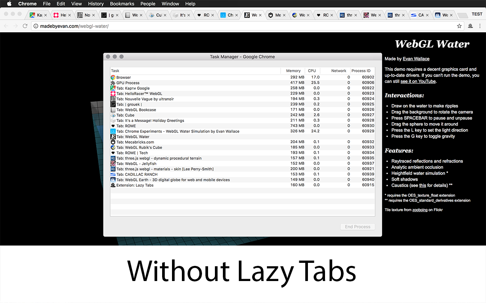
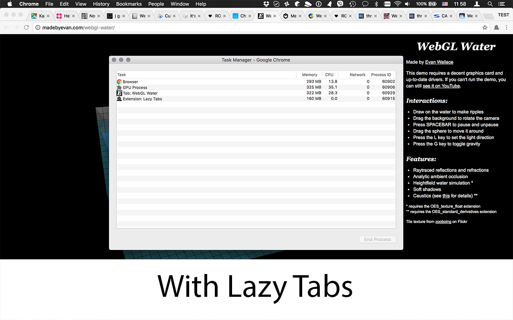

<h1 align="center">Lazy Tabs</h1>

  Faster Chrome startup and lower memory usage — discard inactive tabs automatically, with zero permissions and zero tracking.

  
  
  

Starting Chrome with a bunch of windows and tabs already open reloads *every* one of them right away, even tabs you won't touch for hours. **Lazy Tabs discards all inactive tabs instead** (pinned tabs are left alone) — either automatically at startup or whenever you click its icon. Tabs stay in your tab bar exactly where they were; they just won't load until you switch to them.

## Why Lazy Tabs

- **No permissions requested.** Check `source/manifest.json` yourself — there isn't a `permissions` block.
- **No tracking, no analytics, nothing phoned home.**
- **Open source.** Read the entire extension in one file: [`source/background.js`](source/background.js), under 50 lines.
- **Does one thing.** No settings screen, no upsell, no "pro" tier.

## Before / after

| Previous session, restored normally | With Lazy Tabs |
| --- | --- |
|  |  |

## Install

[Add Lazy Tabs from the Chrome Web Store](https://chromewebstore.google.com/detail/lazy-tabs/aabgbgciohhaogajcnacpgilhmacdahc)

## How it works

On startup, on icon click, or when several tabs are recreated in a burst (e.g. a window restoring), Lazy Tabs walks every open window and discards any tab that is not pinned and not the active tab in a visible window. Discarded tabs keep their title, favicon, and position — Chrome simply hasn't loaded their page yet.

## Found a bug?

Please [open an issue](https://github.com/Jman/lazy_tab/issues) — ideally with your Chrome version and whether tab groups or multiple windows were involved, since those are the trickiest cases to reproduce.

## Release History

### 1.2.0

* Migrate to vite
* Fix regression introduced in 1.1.0. Fix #22
* Add multiple tabs creation detector. Fix #19

### 1.1.0

* Suspend tabs during window restoration. Fix #19

### 1.0.1

* Add types

### 1.0.0

* Update manifest to v3
* Replace npm with pnpm
* Replace babel with esbuild

### 0.5.3

* Remove `tabs` permission request

### 0.5.2 ( thanks to [Mathieu Hofman](https://github.com/mhofman) )

* Discard active tabs if their window is minimized
* Transform the background page into an event page

### 0.5.1

* Update icon

### 0.5.0

* Add click event for discarding tabs

### 0.4.0

* Remove all code, switch to discard algorithm

### 0.3.0

* Move from Grunt to Webpack
* Switch to ES6

### 0.2.1

* Stop page loading
